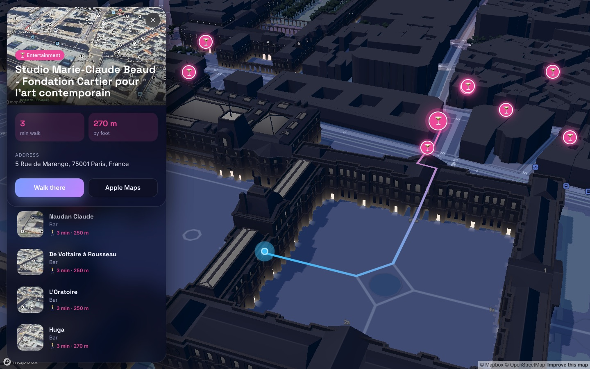
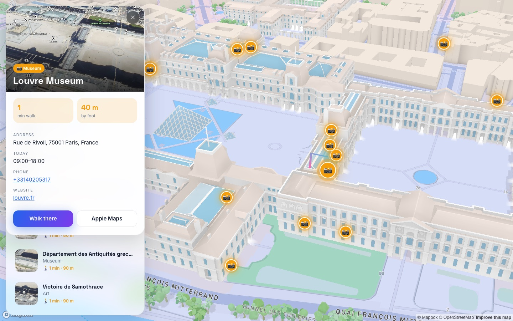
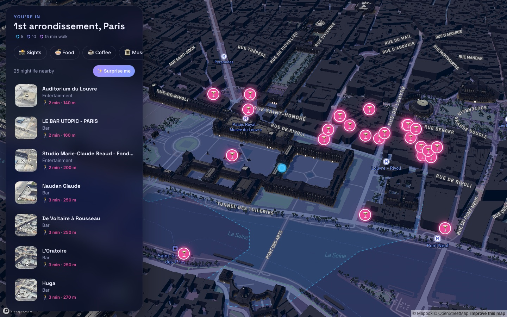
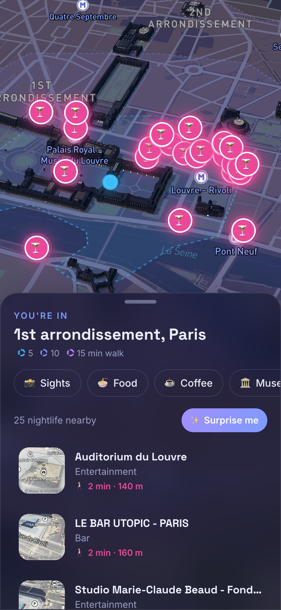
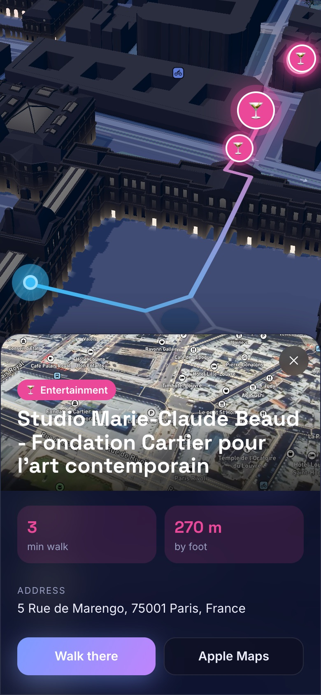
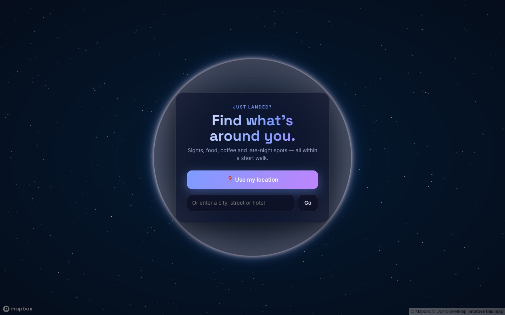
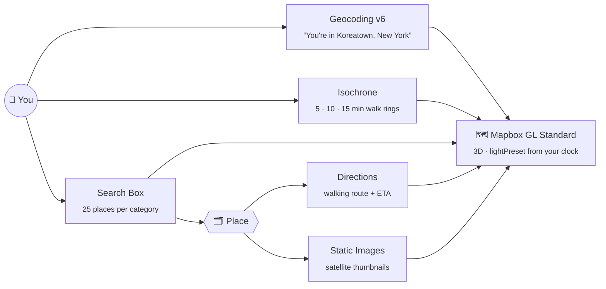

<div align="center">



<br />

**Just landed somewhere new? Open Find Nearby, tap once, and the city unfolds around you in 3D:<br/>sights, food, coffee and late-night spots, with real walking routes and a map that follows the sun.**

<br />

[](https://react.dev)
[](https://vite.dev)
[](https://docs.mapbox.com/mapbox-gl-js/)
[](https://motion.dev)
[](LICENSE)

[](https://github.com/DhrubaDC1/find-nearby/stargazers)
&nbsp;
[](#-contributing)

[**Features**](#-features) · [**Screenshots**](#-screenshots) · [**Quick start**](#-quick-start) · [**How it works**](#-how-it-works) · [**Roadmap**](#-roadmap)

<br />



<sub>Paris at 10 PM: one tap from the Louvre courtyard to the nearest late-night spot, with the walking route drawn in 3D.</sub>

</div>

<br />

## ✨ Features

<table>
<tr>
<td width="50%" valign="top">

### 🌍 Cinematic arrival
You start on a slowly spinning 3D globe. Share your location and the camera **flies from orbit down to your street**, then slowly circles the buildings around you.

</td>
<td width="50%" valign="top">

### 🌗 A map that follows the sun
Dawn, day, dusk and night lighting are picked **from your local clock**, and the whole interface changes color with it. It also changes what opens first: ☕ coffee at dawn, 🍸 bars at night.

</td>
</tr>
<tr>
<td valign="top">

### 🚶 Walking distance at a glance
Glowing **5 / 10 / 15-minute walk rings** (Mapbox Isochrone) show how far you can actually get on foot. Every place shows its walking time, not just a distance.

</td>
<td valign="top">

### 🗺️ Real routes, real ETAs
Tap any place to see a **gradient walking route** drawn in 3D, a real ETA from the Directions API, opening hours, ratings, phone and website, plus one-tap hand-off to Google Maps or Apple Maps.

</td>
</tr>
<tr>
<td valign="top">

### 🎲 Surprise me
Can't decide? One button picks a random place nearby, flies you there and opens it. Handy when you're new somewhere.

</td>
<td valign="top">

### 📱 Made for your phone
On a phone the panels become **bottom sheets**, the camera keeps the map visible above them, and it respects `prefers-reduced-motion`. It's keyboard friendly too (<kbd>Esc</kbd> closes a place).

</td>
</tr>
</table>

<div align="center">

| 📸 Sights | 🍜 Food | ☕ Coffee | 🏛️ Museums | 🌳 Parks | 🍸 Nightlife | 🛍️ Shopping | 🛏️ Stays |
|:-:|:-:|:-:|:-:|:-:|:-:|:-:|:-:|

</div>

## 📸 Screenshots

<div align="center">

### Day ↔ Night, automatically

<table>
<tr>
<td></td>
<td></td>
</tr>
<tr>
<td align="center"><sub>☀️ <b>Day</b>: details, today's hours, one-tap directions</sub></td>
<td align="center"><sub>🌙 <b>Night</b>: the city lights up, bars pop in</sub></td>
</tr>
</table>

### In your pocket

<table>
<tr>
<td width="33%"></td>
<td width="33%"></td>
<td width="33%"></td>
</tr>
<tr>
<td align="center"><sub>Browse by walking time</sub></td>
<td align="center"><sub>Route + ETA</sub></td>
<td align="center"><sub>"Just landed?"</sub></td>
</tr>
</table>

</div>

## 🚀 Quick start

> **You need:** Node 20.19+ and a free [Mapbox public token](https://account.mapbox.com/access-tokens/) (`pk.…`).

```bash
git clone https://github.com/DhrubaDC1/find-nearby.git
cd find-nearby
npm install
cp .env.example .env        # then paste your token into VITE_MAPBOX_TOKEN
npm run dev
```

Open **http://localhost:5173**, tap **📍 Use my location**, and you're in. If you'd rather not share your location, type a city, street or hotel instead.

<details>
<summary><b>📦 Scripts</b></summary>

| Command | What it does |
|---|---|
| `npm run dev` | Dev server with hot reload |
| `npm run build` | Production build to `dist/` (static, so you can host it anywhere) |
| `npm run preview` | Serve the production build locally |
| `npm test` | Run the tests (Node's built-in test runner, no extra dependencies) |

</details>

<details>
<summary><b>🔐 About the token</b></summary>

Mapbox `pk.` tokens are made to be used in the browser, so there's no backend to run. Before deploying, add a **URL restriction** to your token in the [Mapbox dashboard](https://account.mapbox.com/access-tokens/) so only your domain can use it.

</details>

<details>
<summary><b>📲 Test on your phone</b></summary>

Geolocation needs HTTPS. Run `ngrok http 5173` and open the `*.ngrok-free.app` URL on your phone. The dev server already accepts ngrok hosts.

</details>

## 🧠 How it works

Everything comes from Mapbox. There's no backend, no database and no state library: **4 runtime dependencies** in total.



| Need | Mapbox API |
|---|---|
| Where am I? | [Geocoding v6](https://docs.mapbox.com/api/search/geocoding/) (reverse + forward fallback) |
| What's nearby? | [Search Box: category search](https://docs.mapbox.com/api/search/search-box/) |
| How far on foot? | [Isochrone](https://docs.mapbox.com/api/navigation/isochrone/) |
| How do I get there? | [Directions (walking)](https://docs.mapbox.com/api/navigation/directions/) |
| What does it look like? | [Static Images](https://docs.mapbox.com/api/maps/static-images/) (satellite) |
| The map itself | [Mapbox GL JS v3, Standard style](https://docs.mapbox.com/mapbox-gl-js/) |

<details>
<summary><b>🗂️ Project structure</b></summary>

```
src/
├── App.jsx          state, intro, categories, layout
├── MapView.jsx      mapbox-gl: globe, fly-in, pins, rings, route
├── PlaceList.jsx    category chips + animated card list
├── PlaceDetail.jsx  place panel: route ETA, hours, links
├── api.js           every Mapbox call + small formatters
├── light.js         clock → dawn / day / dusk / night
└── styles.css       glass UI, themed per light preset
```

The whole app is about 600 lines of JavaScript, small enough to read in one sitting.

</details>

## 🗺️ Roadmap

- [x] 3D globe intro + cinematic fly-in
- [x] Auto day / dusk / night lighting
- [x] 5/10/15-min walk isochrones
- [x] Walking routes with live ETA
- [x] Opening hours, ratings, phone, website
- [x] Mobile bottom sheets
- [ ] ❤️ Save favorites
- [ ] 🔎 Search-as-you-type for any place
- [ ] 🔗 Shareable links to a place
- [ ] 🌐 Multi-language UI
- [ ] ☀️ Sun-position lighting (real sunrise/sunset instead of fixed hours)

Have an idea? [Open an issue](https://github.com/DhrubaDC1/find-nearby/issues).

## 🤝 Contributing

PRs are welcome! Keep it simple: no new dependency when a few lines will do.

1. Fork and create a branch: `git checkout -b feat/amazing-thing`
2. `npm test && npm run build`
3. Open a PR with a screenshot or GIF of your change

## 📄 License

[MIT](LICENSE) © Dhruba Chakraborty

Map data © [Mapbox](https://www.mapbox.com/about/maps/) © [OpenStreetMap](https://www.openstreetmap.org/copyright) contributors.

<br />

<div align="center">

### ⭐ If Find Nearby helped you find something good, give it a star!

<a href="https://star-history.com/#DhrubaDC1/find-nearby&Date">
  <picture>
    <source media="(prefers-color-scheme: dark)" srcset="https://api.star-history.com/svg?repos=DhrubaDC1/find-nearby&type=Date&theme=dark" />
    
  </picture>
</a>

<sub>Built with ☕ and Mapbox, for everyone who's ever landed somewhere and wondered <i>"what's good around here?"</i></sub>

</div>
